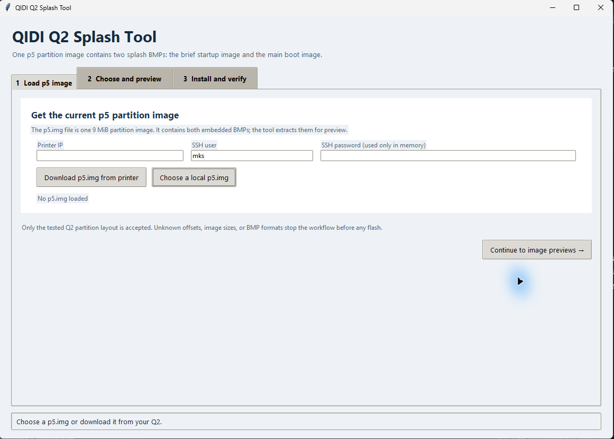
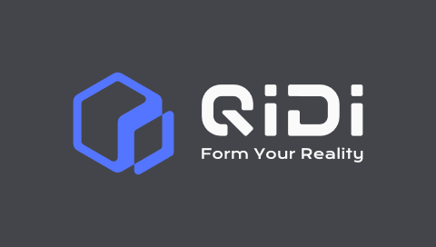
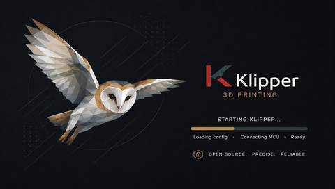

# QIDI Q2 boot splash tools

Unofficial tools to inspect and replace the boot splash images on a QIDI Q2. The tested offsets and timing below were confirmed on one Q2; other firmware versions and printer models are not yet verified. This project is not affiliated with QIDI.

## Hardware compatibility

This project has been tested on one QIDI Q2. Other Q2 hardware or firmware revisions and the Q2C have not been verified. QIDI's public specifications do not list the application-processor and partition details for every production revision.

The tested partition was `/dev/mmcblk0p5`, exactly 9,437,184 bytes, with valid 480 × 272 splash BMPs at the offsets listed below. You can inspect a printer over SSH with these read-only commands:

```sh
tr -d '\000' </proc/device-tree/model; echo
lsblk -b -o NAME,SIZE,TYPE,MOUNTPOINT
sudo blockdev --getsize64 /dev/mmcblk0p5
```

The wizard checks the partition size and BMP headers, verifies the upload and backup hashes, and compares a read-back hash after writing. These checks confirm the image structure and that the write completed as intended; they cannot guarantee that every hardware or firmware revision uses the same splash locations. If the partition size or BMP checks fail, stop and do not flash. The tested offsets and timing are observations from one Q2.

## What is in `p5.img`?

`p5.img` is one 9 MiB image of the printer's `/dev/mmcblk0p5` partition. It contains two embedded 480 × 272, uncompressed 24-bit BMP splash images. It is not a bundle of two `.img` files.

| Offset | Boot image | Observed duration on the tested Q2 |
|---|---|---|
| `0x647000` | First splash | About 1 second |
| `0x6A6C00` | Main splash | For the rest of boot |

The patching tools replace only the BMP pixel data. By default, they put the same artwork in both slots so the old image does not flash briefly before the main splash. You can also provide separate artwork for each slot.

## Option A: Wizard workflow (Windows and Linux)

The wizard downloads and previews the two splash images, prepares a patched partition image, makes and checks a backup, flashes, verifies the read-back, restarts the printer, and reconnects over SSH. One click on **Back up, flash & restart** starts the full sequence. If checks fail, it stops; it will not restart unless the written data matches. Reconnection is limited to three minutes.

Windows users can download the standalone [QIDI-Q2-Splash-Tool.exe](https://github.com/JP-Reitsma/Qidi-Boot-Splash/releases/latest/download/QIDI-Q2-Splash-Tool.exe) from the [latest release](https://github.com/JP-Reitsma/Qidi-Boot-Splash/releases/latest); it does not require Python. Windows may show a SmartScreen warning because the executable is not code-signed.\n\nTo run the wizard from source, install Python 3.10 or newer and download the repository using **Code → Download ZIP**. Extract the ZIP to a folder.

On Windows, use PowerShell in that folder:

```powershell
py -m pip install -r requirements.txt
py qidi_splash_tool.py
```

On Linux, install `python3-tk` if needed, then run:

```sh
python3 -m pip install -r requirements.txt
python3 qidi_splash_tool.py
```

Enter the printer's IP address, SSH user (usually `mks`), and password. The password is held in memory only. When prompted about an SSH host key, compare its fingerprint through a trusted channel before accepting.



## Option B: Terminal workflow (Windows and Linux)

Install Python 3.10 or newer and the packages listed in `requirements.txt`. The command-line tools do not need Tkinter.

Replace `<printer-ip>` below with the printer's address. First open an interactive SSH session so `sudo` can ask for its password, make a backup, then download it:

```sh
ssh mks@<printer-ip>
sudo dd if=/dev/mmcblk0p5 of=/home/mks/p5_original.img bs=1M conv=fsync
stat -c '%s' /home/mks/p5_original.img
exit
scp mks@<printer-ip>:/home/mks/p5_original.img ./p5.img
```

Check that `p5.img` is exactly 9,437,184 bytes. In the commands below, use `py` instead of `python` in PowerShell, or `python3` on Linux if `python` is unavailable. Extract the two embedded images as separate preview files:

```sh
python extract_bmps.py
```

The previews are written under `output/`. The source partition image remains a single file.

Use one new image for both boot moments:

```sh
python patch_bootlogo.py ./p5.img ./my-logo.png --output ./p5_patched.img
```

Or use separate images for the brief first splash and the main splash:

```sh
python patch_bootlogo.py ./p5.img --startup-artwork ./startup.png --main-artwork ./main.png --output ./p5_patched.img
```

The patcher center-crops and resizes artwork to 480 × 272. It checks both embedded BMP headers and writes a separate output image. Review the artwork before flashing.

Upload the output and start another interactive SSH session:

```sh
scp ./p5_patched.img mks@<printer-ip>:/home/mks/
ssh mks@<printer-ip>
```

On the printer, confirm the uploaded size and hash, and make a fresh backup before writing:

```sh
stat -c '%s' /home/mks/p5_patched.img
sha256sum /home/mks/p5_patched.img
sudo dd if=/dev/mmcblk0p5 of=/home/mks/p5_before_flash.img bs=1M conv=fsync
stat -c '%s' /home/mks/p5_before_flash.img
```

Compare the uploaded hash with the local file (`Get-FileHash .\p5_patched.img -Algorithm SHA256` in PowerShell or `sha256sum ./p5_patched.img` on Linux). Stop if the image or backup is not 9,437,184 bytes or the hashes differ. Copy the backup off the printer before continuing.

Only after confirming the correct printer, partition, image size, transfer hash, and backup, flash and read back the partition:

```sh
sudo dd if=/home/mks/p5_patched.img of=/dev/mmcblk0p5 bs=1M conv=fsync
sudo dd if=/dev/mmcblk0p5 of=/tmp/p5_verify.img bs=1M conv=fsync
sha256sum /home/mks/p5_patched.img /tmp/p5_verify.img
```

Reboot only if the two hashes match:

```sh
sudo reboot
```

Do not interrupt the write. If the read-back hash differs, do not reboot; investigate and restore the backup if needed.

## Example artwork

 

*Original boot splash and an example artwork included with permission from the project owner.*

## Included tools

- `qidi_splash_tool.py` — graphical Windows/Linux wizard.
- `extract_bmps.py` — finds BMP images embedded in a partition or firmware image.
- `extract_rsce_bmps.py` — scans firmware images for BMPs after an `RSCE` resource section.
- `patch_bootlogo.py` — replaces the two splash images.

Firmware images, extracted BMP previews, generated outputs, backups, and other personal artwork are not included. Use a fresh partition image from your own printer. Do not assume the tested offsets or partition apply to another model or firmware version.

